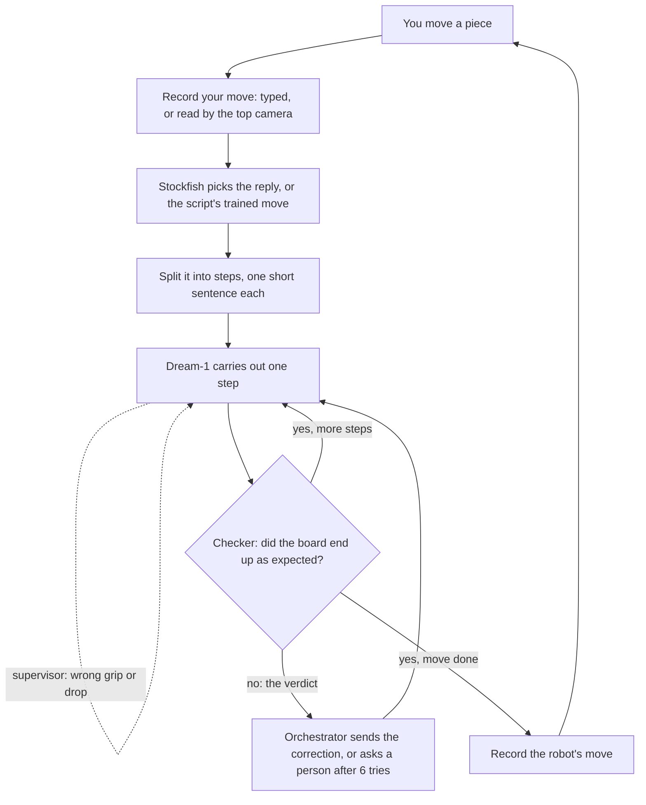
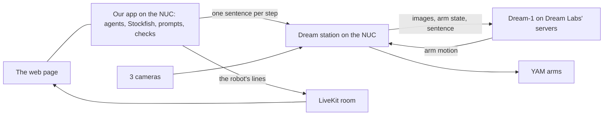

# Dream Chess

YAM bimanual robot arms play chess against a person, using Dream Labs' Dream-1 model to move the pieces. A team of
agents does everything else: an orchestrator runs the game and picks every move with Stockfish, a supervisor watches
each move as it happens and re-prompts Dream-1 mid-run, a checker confirms each result with the top camera, and the
robot speaks over LiveKit. All of it is live on one web page.


*This simulation runs the real decision and retry code. The robot and camera are simulated and the failures are
scripted, so it shows the logic, not real-robot accuracy. Download [docs/simulation.html](docs/simulation.html) and
open it in a browser to step through it.*

## The idea in one minute

Dream-1 is a robot model: it looks at three camera images, reads one sentence, and moves the arms. It doesn't know
chess, can't see the board as a grid, remembers nothing between instructions, and never says whether it succeeded.

So the agents do everything else:

- **Know the game.** The orchestrator keeps the board, and changes it only once a move is confirmed.
- **Choose the move.** Stockfish picks the best move each turn.
- **Say it simply.** Each move becomes one or more pick-and-place steps, each one short sentence that names the arm,
  the piece, and where from and where to, in words Dream-1 can see from its seat.
- **Hold Dream-1's hand.** The supervisor follows the hand during the move and corrects it without stopping the arms.
- **Check the result.** The checker takes a top-camera picture after each step; on a mismatch, the verdict goes back
  to the orchestrator, which sends a correction, until the board is right or a person is asked.

In short, **the agents are the brain of the game, Dream-1 is the robot's brain for motion, and LiveKit is its voice.**

## The agents and their tools

| | What it is | Its one job |
| --- | --- | --- |
| **Orchestrator** | Agent: the game loop (`orchestrator.py`) | Runs the game: decides what happens next, calls each tool, retries, asks for help |
| **Supervisor** | Agent: watches the move live (`supervisor.py`) | Follows the hand from the arms' joint angles; re-prompts Dream-1 mid-run if it grips an empty square or the wrong piece, or lets go in the wrong place; ends the run once the piece lands |
| **Checker** | Agent: the top camera (`checker.py`) | After each step, a picture read into the board, and a verdict in words: "the brown queen went to b2 instead of c2" |
| **Voice** | Agent: LiveKit (`voice.py`) | Says each robot move and reacts to yours |
| Stockfish | Tool: a chess engine | Given a position, returns the best move |
| Dream-1 | Tool: a robot model, run by the station, via DreamAPI | Given one sentence, moves the arms |
| A person | Tool, when needed | Fixes the board when the agents can't; confirms steps if camera checks are off |

The agents follow fixed rules rather than a language model, so every prompt matches the wording Dream-1 was trained
on, costs nothing, and adds no delay. The only AI models in the loop are Dream-1 (motion) and LiveKit's speech.

## One game, step by step

The robot plays Brown (Black), so the person moves first.



1. **You move** a piece, then enter it on the page (type it, tap it on the board, or press *I've made my move* and the
   top camera reads it).
2. **Stockfish chooses the reply**, or, when replaying a collection game (`--script`), the robot plays the move from
   the game it was trained on.
3. **What and Where.** Some moves need several steps:

   | Move | Steps |
   | --- | --- |
   | Normal move | Move the piece |
   | Capture | Move your piece to the tray, then move the robot's piece onto the square |
   | Castling | Move the king, then the rook |
   | Promotion | Move the pawn to the tray, then place a spare queen from the tray |

4. **How.** Each step becomes one sentence for Dream-1:

   > Using your right arm, pick up the brown knight at Column (b), Row (8) (nearest row, 2nd from your right) and
   > place it at Column (c), Row (6) (3rd row, 3rd from your right). Move slowly and do not touch any other piece.

   The station runs Dream-1 for up to 60 seconds of motion. Time the arms spend waiting on DreamAPI doesn't count,
   and a model still starting up is waited out. Meanwhile the **supervisor** watches the hand and corrects it mid-run.
5. **Check.** The **checker** takes a top-camera picture and reads the board:
   - **Right:** go on to the next step, or finish the move.
   - **Wrong:** the verdict goes back up ("the brown rook is still on b8"), and the orchestrator sends a one-line
     follow-up: "Using your right arm, move the brown rook from Column (b), Row (3) (...) to Column (b), Row (1) (...)".
   - **6 tries fail:** ask a person to fix the board, saying exactly what's needed.
6. **Record the move.** The game's board changes only once every step is confirmed. Then it's your turn again.

## What Dream-1 needs from us

Dream-1 sees the board through its cameras, but nothing tells it what "b8" means: the printed edge labels are tiny in
its pictures. So every instruction follows the same rules:

- **Name squares two ways:** the board's labels as `Column (b), Row (8)`, which did a little better than "square b8"
  on the robot, and where that is from the robot's seat ("nearest row, 2nd from your right").
  `--prompt-style squares` sends our demos' exact wording instead; `spatial` sends the description alone.
- **Name the colors as they look:** the robot's pieces are "brown", the opponent's "white".
- **Name the arm on the piece's side:** seated behind rank 8, the robot has the a-file at its right.
- **Name the piece, even in a fix** ("the brown rook"): the camera only tells colors apart, but the game knows which
  piece belongs where.
- **One pick-and-place per instruction**, and **follow-ups are one short line**: the arm, piece and goal are already set.

## Where it runs

Everything runs on the station's computer (the NUC), and you watch it in a browser.



The Dream station drives the arms, owns the cameras, runs Dream-1 with its own safety limits, and accepts
instructions through a local API. It keeps its cameras to itself and saves frames only during a run, so the checker's
picture is a "hold still" run stopped before Dream-1's first motion: the arms stay at home, and the picture stays in
memory.

## Status

| Part | Status |
| --- | --- |
| Game logic, Stockfish moves, steps and sentences | ✅ Tested, including on real Stockfish (installed on the NUC) |
| Sending steps to the station, warm-up, waiting out DreamAPI stalls | ✅ Run on the real robot |
| Base model and a first fine-tune (game 1 data) on the real robot | ✅ Run; both struggle with long moves they weren't trained on |
| Supervisor (live re-prompting) and checker (top camera) | ✅ Tested in simulation, on replays of real runs, and against a fake station; first real runs at the demo |
| Robot voice over LiveKit, on the page | ✅ Set up on the NUC |
| Our fine-tunes on all 58 cleaned demos (`chess-1k`, `chess-2k`) | ⏳ Training on Dream's servers |

See [docs/AUDIT.md](docs/AUDIT.md) for what the live runs showed and how to get the robot making the right moves.

## The app

`app.py` shows the whole system at work, live, on one screen:

- **How the agent plays**: the loop of Eyes, Agent, Stockfish, Dream-1, Arms and Check, each lighting up as it works.
- **The robot's eyes**: the top camera's last picture, the squares and pieces the vision code found on it, and the
  board it read. **Camera checks are optional**: two pictures (the empty board, then the starting position) turn them
  on; without them, you confirm each step.
- **The robot's brain**: Dream-1 via DreamAPI. The exact sentence sent, the arm and attempt, whether the model is
  warming up or ready on DreamAPI, the station's round trip and inference time, and the hand's square and grip,
  watched live.
- **The robot's voice**: LiveKit. Bars that move while the robot speaks, its last line, and *Listen* to hear it in
  the page.
- **The game**, seen from your side or the robot's, and **this move, step by step**, with the last five commands
  sent to Dream-1.
- **Restart game** at any time (it stops the arms first), **Stop the arms**, and dark or bright mode.

```bash
python app.py --sim --auto-opponent         # dummy data: watch a simulated robot play itself
python app.py --script 2                    # the real robot replays collection game 2 (trained moves)
python app.py --script 2 --voice livekit    # ...and speaks over LiveKit (keys in .env, never committed)
python app.py --checkpoint "dream-1-ft:..." # a fine-tuned model instead of the base model
```

Then open http://127.0.0.1:8800. On the NUC, forward it first with `ssh -L 8800:127.0.0.1:8800 dream-nuc`.

## Try it

On any computer, with no robot:

```bash
python -m venv .venv
source .venv/bin/activate            # Windows: .venv\Scripts\activate
pip install -r requirements.txt

pytest                               # about 3 minutes
python app.py --sim --auto-opponent  # the app, with a simulated robot
```

On the NUC, with the station idle and **a person's hand on the e-stop**: see [docs/RUNBOOK.md](docs/RUNBOOK.md).
Every game is logged to `games/`, ending with a summary: robot moves, Dream-1 attempts, automatic fixes, human
rescues, and moves per hour.

## Code map

| Part | File |
| --- | --- |
| The orchestrator: the game loop, retries, and fixes | `dreamchess/orchestrator.py` |
| What and Where: pick the piece and square, plan the steps, write each sentence | `dreamchess/what.py`, `dreamchess/where.py` |
| Stockfish | `dreamchess/engine.py` |
| How: send a step to the station, wait out warm-ups and stalls | `dreamchess/station_mover.py` |
| Warm the model up before the first move | `tools/warm_dream.py` |
| The supervisor and the hand tracker | `dreamchess/supervisor.py`, `dreamchess/hands.py`, `tools/hand_watch.py`, `tools/fit_board.py` |
| The checker and the top camera | `dreamchess/checker.py`, `dreamchess/station_camera.py`, `dreamchess/webcam.py`, `dreamchess/vision.py` |
| The voice | `dreamchess/voice.py`, `dreamchess/livekit_voice.py` |
| Replaying a collection game | `dreamchess/scripts.py` |
| A person standing in for the camera | `dreamchess/human_eyes.py` |
| The app and its page | `app.py`, `dreamchess/app_page.html`, `dreamchess/app_vision.py`, `run_robot.py` |
| Dream-1 eval | `eval_dream.py`, `dreamchess/evaluation.py` |
| Simulation and visuals | `dreamchess/mock.py`, `dreamchess/synth.py`, `dreamchess/replay.py`, `visualize.py` |

## More docs

- [docs/RUNBOOK.md](docs/RUNBOOK.md): from arriving at the station to a game on screen.
- [docs/AUDIT.md](docs/AUDIT.md): how the system works, what the live runs showed, and how to get the right moves.
- [docs/MISSION.md](docs/MISSION.md): the decisions and why.
- [docs/EVAL.md](docs/EVAL.md): testing Dream-1 and planning fine-tuning data.
- [docs/COLLECTION_GAMES.md](docs/COLLECTION_GAMES.md): the scripted games used to collect fine-tuning data.

## Safety

- A person keeps a hand on the e-stop whenever the arms can move. *Stop the arms* on the page, or Ctrl-C, stops them
  at once.
- A person, not a coding agent, runs `python -m dream.check_loop`, `python -m dream.input_check`, and `dreamcli tcp`.
  The Dream docs require this.
- Never commit keys. The station reads its Dream key from `~/.dreamlabs/credentials`; the LiveKit keys go in `.env`,
  which git ignores. The page only ever gets a listen-only LiveKit pass.
