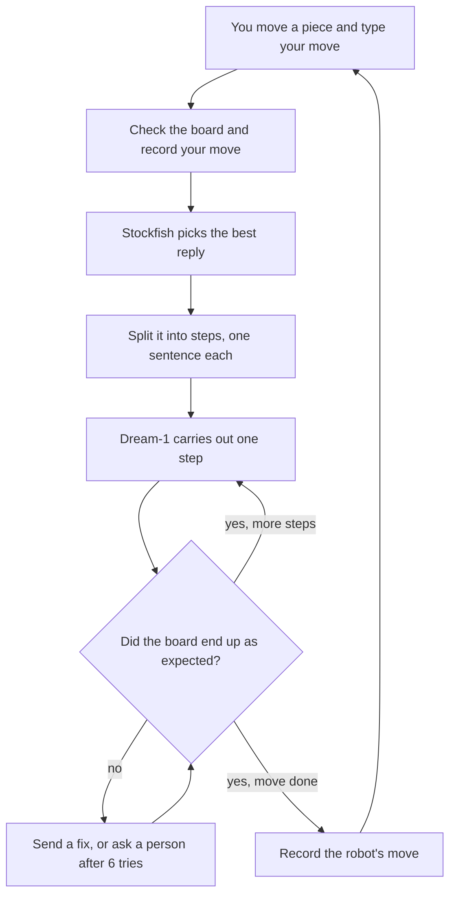
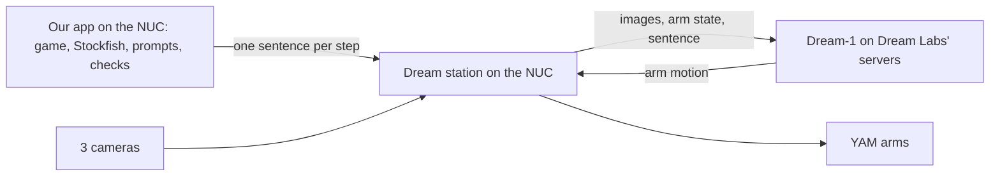

# Dream Chess

YAM bimanual robot arms play chess against a person, using Dream Labs' Dream-1 model to move the
pieces. Our app is the brain: it keeps track of the game, chooses every move with Stockfish, tells
Dream-1 exactly what to do one step at a time, and checks each result before trusting it.


*This simulation runs the real decision and retry code. The robot and camera are simulated and the
failures are scripted, so it shows the logic, not real-robot accuracy. Download
[docs/simulation.html](docs/simulation.html) and open it in a browser to step through it.*

## The idea in one minute

Dream-1 is a robot model: it looks at three camera images, reads one sentence such as "pick up the
brown knight on g8 and place it on f6", and moves the arms. It's good at that, but it doesn't
know chess, can't see the board as a grid, remembers nothing between instructions, and never says
whether it succeeded.

So the app does everything else:

- **It knows the game.** It starts from the standard position and updates the board after every
  confirmed move.
- **It chooses the move.** Stockfish, a chess engine, picks the best move each turn.
- **It turns the move into instructions.** Each move becomes one or more single pick-and-place
  steps, each described in one plain sentence.
- **It checks the result.** After each step, it compares the real board with what it expected,
  sends a fix if something is wrong, and asks a person for help if it can't.

In short, **the app is the brain and Dream-1 is the hands.**

## The agent and its tools

| | What it is | Its one job |
| --- | --- | --- |
| **Orchestrator** | **The agent:** our Python loop | Runs the game: decides what happens next, calls each tool, retries, and asks for help |
| Stockfish | Tool: a chess engine | Given a position, returns the best move. It remembers nothing between calls |
| Dream-1 | Tool: a robot model, run by the station | Given one sentence, moves the arms |
| Top camera | Tool | Shows which squares hold a white or brown piece |
| A person | Tool, when needed | Fixes the board when the robot can't |

## One game, step by step

The robot plays Brown (Black), so the person moves first.



1. **You move** a piece, then type your move, such as `e4`. The app checks it's legal and records it.
2. **Stockfish chooses the reply.** The app sends it the whole game so far, and it returns the best
   move, such as knight g8 to f6. It plays this move every time, without simplifying it for the
   robot.
3. **What and Where.** *What* is the piece that move picks up, and *Where* is the square it goes to.
   Some moves need several steps:

   | Move | Steps |
   | --- | --- |
   | Normal move | Move the piece |
   | Capture | Move your piece to the tray, then move the robot's piece onto the square |
   | Castling | Move the king, then the rook |
   | Promotion | Move the pawn to the tray, then place a spare queen from the tray |

4. **How.** Each step becomes one sentence for Dream-1:

   > Using your left arm, pick up the brown knight on square g8 and place it upright in the center
   > of square f6. Move slowly and do not touch any other piece.

   The app sends it to the station, which runs Dream-1 for up to 30 seconds, then moves the arms
   home, out of the camera's view.
5. **Check.** The app compares the board with what it should look like after that step:
   - **Right:** go on to the next step, or finish the move.
   - **Missed the grab:** send the same step again.
   - **Wrong square, or another piece bumped:** send a fix, such as "pick up the brown piece on g6
     and place it on f6".
   - **A piece is gone, or 6 tries fail:** ask a person to fix the board, saying exactly what's
     needed.
6. **Record the move.** The app's board changes only once every step is confirmed, so it never
   believes a move happened when it didn't. Then it's your turn again.

## What Dream-1 needs from us

Because Dream-1 only has camera images and one sentence, every instruction follows the same rules:

- **Name the colors as they look:** the robot's pieces are "brown" and the opponent's are "white".
- **Name squares by their board labels**, such as g8 and f6. Our app knows where every square is,
  but Dream-1 only knows if it can find the labels printed on the board's edge, so a clear,
  well-lit board matters.
- **Name the arm on the piece's side:** seated behind rank 8, the robot has the h-file at its left.
  Captures go to the tray beside that same arm.
- **One pick-and-place per instruction.** Dream-1 starts fresh each time, so no instruction relies
  on an earlier one.
- **Fixes name only the color** ("the brown piece on g6"), because the camera can tell colors
  apart but not piece types.

Whether Dream-1 can follow these well enough is what the eval measures. See
[docs/EVAL.md](docs/EVAL.md). If it struggles, fine-tuning on demos in this exact scene, using
these same sentences, is how it improves.

## Where it runs

Everything runs on the station's computer (the NUC). There's no web frontend, just a terminal.



The Dream station already runs on the NUC: it drives the arms, owns the cameras, runs Dream-1 with
its own safety limits, and accepts instructions through a local API. Our app sends each step
there.

The station keeps the top camera to itself, so for now **a person stands in for the camera**: after
each robot step, the app asks whether the piece landed. Once the station shares its camera, the
camera code takes over and nothing else changes.

## Status

| Part | Status |
| --- | --- |
| Game logic, Stockfish moves, steps and sentences | ✅ Tested, including on real Stockfish |
| Retries, fixes, and asking for help | ✅ Tested in simulation |
| Sending steps to the station | ✅ Tested against a fake station; not yet on the real one |
| Playing a full game (`run_robot.py`) | ✅ Tested against a fake station; not yet on the real robot |
| Dream-1 eval on the real robot | ▶️ Ready to run |
| Camera check on the real board | ⚠️ Waiting for approval to change the station's configuration |
| Stockfish on the NUC | ⚠️ Not installed yet, so games there use a weak built-in engine |

## The app

`app.py` shows the whole agent at work, live, on one screen:

- **How the agent plays**: the loop of Eyes, Agent, Stockfish, Dream-1, Arms and Check, each lighting up as it works.
- **The robot's eyes**: the camera frame, the grid and pieces the vision code found on it, and the board it read,
  with any square that differs from the game marked. In a simulation, a simulated top camera is read by the real
  vision code. On the robot, it shows the frames the station hands Dream-1 (top and both wrists).
- **The robot's brain**: Dream-1 via DreamAPI. It shows the exact sentence the agent sent, the arm, the attempt, and,
  on the robot, the station's own status: round trip, inference time, action chunks.
- **The game** and **this move, step by step**: your move, What, Where, How, Check and Record.
- **Activity**: the full log, folded to its latest line until you open it.

Everything the person needs to do, from confirming the e-stop to saying whether a piece landed, happens on the page.

```bash
python app.py --sim --auto-opponent      # dummy data: watch a simulated robot play itself
python app.py --sim                      # play the simulated robot from the page
python app.py                            # the real robot, on the NUC (see docs/RUNBOOK.md)
```

Then open http://127.0.0.1:8800. On the NUC, forward it first with `ssh -L 8800:127.0.0.1:8800 dream-nuc`.

## Try it

On any computer, with no robot:

```bash
python -m venv .venv
source .venv/bin/activate            # Windows: .venv\Scripts\activate
pip install -r requirements.txt

pytest                               # about 3 minutes
python run_robot.py --sim            # play a game against a simulated robot
python dev_server.py                 # live dashboard at http://127.0.0.1:8765
```

On the NUC, with the station idle and **a person's hand on the e-stop**:

```bash
.venv/bin/python run_robot.py                                     # play a game
.venv/bin/python run_robot.py --fen "<position>"                  # start from a short mate
.venv/bin/python eval_dream.py run --label baseline --setup "edge labels: yes"   # Dream-1 eval
```

Every game is logged to `games/`, ending with a summary: robot moves, Dream-1 attempts, automatic
fixes, human rescues, and moves per hour. Ctrl-C stops the arms at once.

## Code map

| Part | File |
| --- | --- |
| The agent: the game loop, retries, and fixes | `dreamchess/orchestrator.py` |
| What: pick the piece | `dreamchess/what.py` |
| Where: pick the square, plan the steps, write each sentence | `dreamchess/where.py` |
| Stockfish | `dreamchess/engine.py` |
| How: send a step to the station | `dreamchess/station_mover.py` |
| Check: read the board from the camera | `dreamchess/vision.py`, `vision_tool.py` |
| A person standing in for the camera | `dreamchess/human_eyes.py` |
| Play a real game: the app, or the terminal | `app.py`, `dreamchess/app_page.html`, `dreamchess/app_vision.py`, `run_robot.py` |
| Watch a data collection session | `collect_watch.py` |
| Dream-1 eval | `eval_dream.py`, `dreamchess/evaluation.py` |
| Simulation and visuals | `dreamchess/mock.py`, `dreamchess/synth.py`, `dreamchess/replay.py`, `visualize.py` |
| Live dashboard | `dev_server.py` |
| Direct Dream-1 connection, a fallback if the station isn't used | `dreamchess/dream_mover.py` |

## More docs

- [docs/MISSION.md](docs/MISSION.md): the decisions and why, and how we'll know it's working.
- [docs/GAME_PLAN.md](docs/GAME_PLAN.md): who does what, and the order to test in.
- [docs/EVAL.md](docs/EVAL.md): testing Dream-1 and planning fine-tuning data.
- [docs/RUNBOOK.md](docs/RUNBOOK.md): from arriving at the station to a game on screen.
- [docs/COLLECTION_GAMES.md](docs/COLLECTION_GAMES.md): the scripted games used to collect fine-tuning data.

## Safety

- A person keeps a hand on the e-stop whenever the arms can move.
- A person, not a coding agent, runs `python -m dream.check_loop`, `python -m dream.input_check`,
  and `dreamcli tcp`. The Dream docs require this.
- Never commit API keys. The station reads its key from `~/.dreamlabs/credentials`, and our app
  never needs it.
